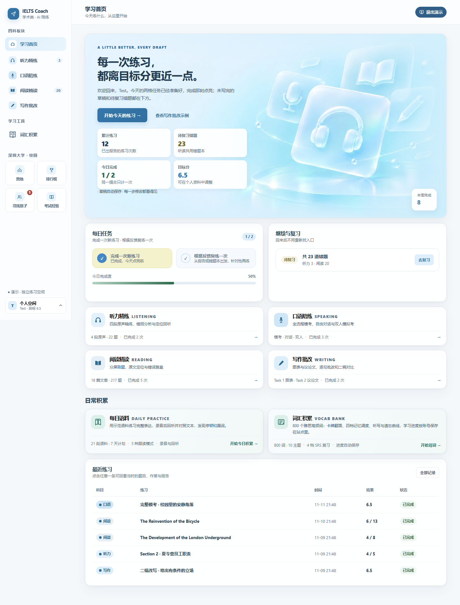
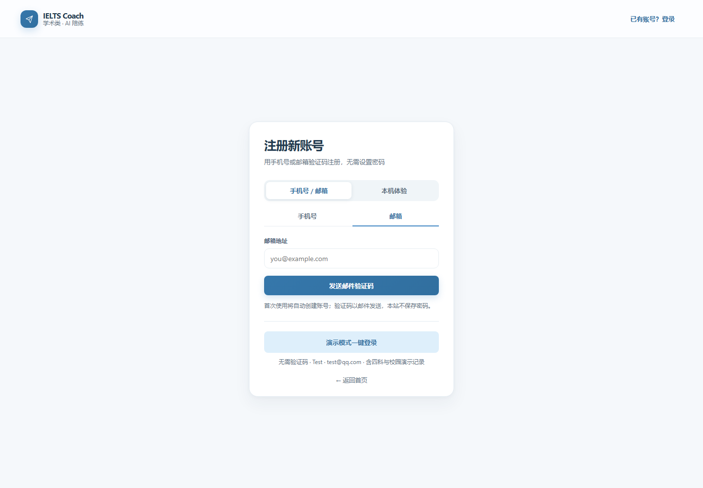

<div align="center">

# IELTS Coach

**面向校园自学场景的雅思 AI 陪练平台**

让每一次反馈，都成为下一次练习的起点。

[核心功能](#核心功能) · [校园特色](#校园特色) · [界面预览](#界面预览) · [快速开始](#快速开始)

</div>

## 项目介绍

IELTS Coach 面向自学备考的大学生，将听、说、读、写、词汇积累与同校互助放进一个学习空间。

围绕「练习 → 反馈 → 复练 → 积累」组织学习：听力回到原声找错因，阅读回到原文找依据，口语回听自己的表达，写作对照逐句建议修改。练习中遇到的具体问题，还可以带到校园互助中，与同校伙伴共同解决。

项目以深圳大学为校园示范场景，既支持个人训练，也把课余时间、同学的优势与宿舍班级的小队关系转化为学习资源。

## 核心功能

| 模块 | 主要能力 |
| --- | --- |
| 🎧 **听力精练** | 原声分段练习、题型专项、逐句定位回听、错因记录与针对性复练。 |
| 🎙️ **口语陪练** | Part 1–3 全流程模考、自由对话、双人模拟考、录音转写与回听、评测报告、每日跟读。 |
| 📖 **阅读精读** | 原文与题目独立滚动、逐题解析与证据定位、错题复练、生词收藏及精读资料。 |
| ✍️ **写作批改** | Task 1 图表与 Task 2 议论文训练、逐句批注、改写建议、参考范文、原稿保留和二稿对比。 |
| 🗂️ **词汇积累** | 高频词翻卡、释义与例句、发音、四档掌握标记、间隔复习、听写及学习记录。 |

学习首页集中展示每日任务、待复习问题和最近记录；历史报告、分数曲线与错题本帮助学习者决定下一步练什么。

## 校园特色

校园协作从已有的学习问题出发，连接真实的时间安排与同学关系。

| 功能 | 在校园中的价值 |
| --- | --- |
| **同校搭子广场** | 结合水平、目标、强弱项与共同空档寻找伙伴，接受邀请后约好具体练习，把零散课余时间用起来。 |
| **同校互助单** | 带着原题、作答或录音求助，通过认领、回复和复练，把同学的优势变成彼此可用的学习资源。 |
| **四人小队挑战** | 宿舍、班级或学院组队，查看四科周任务与队员贡献，让同伴的行动带动自己的坚持。 |
| **校级目标与练习证据** | 对照学校公开要求，查看已有练习证据与推荐训练，让备考与校园中的实际需要衔接。 |
| **校园营地与积分榜** | 有效练习和互助积累积分，点亮营地、投喂校园猫、参与本校排行，把个人努力汇成共同成长。 |

## 界面预览

以下为项目实际界面的演示账号截图，分数和学习记录为示例数据。

<details>
<summary><strong>学习首页：四科训练、每日任务与学习积累</strong></summary>



</details>

<details>
<summary><strong>登录 / 注册：一键进入 Test 演示空间</strong></summary>



</details>

## 快速开始

需要 **Node.js 24 或以上**。仓库包含已构建的前端与服务端运行文件，可以直接启动：

```bash
git clone https://github.com/CharlieChen2007/IELTS-Coach.git
cd IELTS-Coach
node scripts/release-integrity.mjs verify
node scripts/start.mjs
```

打开 **http://127.0.0.1:4192/#/auth?mode=signup**，点击 **「演示模式一键登录」**：

- 昵称：`Test`
- 演示资料邮箱：`test@qq.com`
- 无需验证码，自动载入四科与校园示例记录。

首次启动会自动创建 SQLite 数据库。一键演示使用独立学习空间，个人记录与演示记录分开保存。

## 技术实现

| 层级 | 技术与职责 |
| --- | --- |
| 前端 | React、TypeScript、Vite；统一学习工作区与校园入口。 |
| 服务端 | Node.js 24；账号作用域、业务接口、模型调用与资源服务。 |
| 数据 | SQLite；练习、作答、报告和校园协作记录。 |
| AI 反馈 | DeepSeek 服务端适配；对话、写作批改与听读深入解释。 |
| 语音 | 浏览器录音与语音识别、腾讯云 SOE 发音评测；能力由浏览器与服务配置决定。 |

真实 AI 请求和腾讯 SOE 评测需要部署端配置密钥；验证码登录需要认证服务。未配置这些外部服务时，仍可体验题库、基础反馈与预置演示流程。练习估分和示例报告不代表雅思官方成绩。

## 开发与部署

修改前端源码时：

```bash
npm ci
npm run build
```

源码或构建产物变更并完成验收后，使用 `node scripts/release-integrity.mjs freeze` 更新发布清单，再启动服务。

密钥通过服务器环境变量提供，参考 [deploy.env.example](deploy.env.example)。公网部署需要 Node 服务、HTTPS 与持久化数据目录；仓库不包含 API 密钥、个人数据库或用户录音。

- [开发与运行入口](GITHUB-START.md)
- [部署与环境配置](docs/一键演示登录-部署交接.md)
- [AI 接入范围](docs/AI接入验收-2026-11-10.md)
- [原始交付、验收与素材说明](docs/原始交付与验收说明-2026-11-11.md)

---

**IELTS Coach｜让每一次反馈，都成为下一次练习的起点。**
